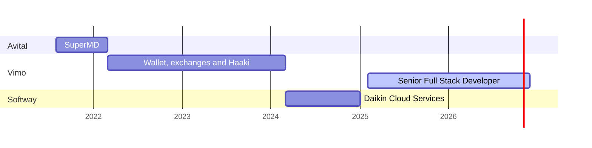
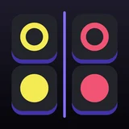

<a href="https://nafish.me">
  <picture>
    <source media="(prefers-color-scheme: light)" srcset="assets/header-light.svg">
    
  </picture>
</a>

<p>
  
  <a href="https://nafish.me"><b>nafish.me</b></a> &nbsp;·&nbsp;
  <a href="https://idexa.app"><b>idexa.app</b></a> &nbsp;·&nbsp;
  <a href="https://www.linkedin.com/in/nafish-ahmed-dev">LinkedIn</a> &nbsp;·&nbsp;
  <a href="mailto:hello@nafish.me">hello@nafish.me</a>
</p>

```ts
const nafish = {
  role: 'Senior Full Stack Developer',
  at: 'Vimo Software', // rejoined in Feb 2025, after a year at Softway
  based: 'Bengaluru, India',
  builds: ['wallet and remittance backends', 'exchange integrations', 'API gateways'],
  stack: ['TypeScript', 'Node.js', 'React', 'Next.js', 'React Native', 'Flutter'],
  sideProject: { name: 'IDEXA', what: 'an independent app studio', url: 'https://idexa.app' },
} as const;
```

## The day job

**Vimo Software** · *Senior Full Stack Developer, Feb 2025 to now*
Real-time transaction confirmation, financial and blockchain API integrations, encrypted secrets infrastructure, API gateway services, and the move from legacy code to React, Node.js and TypeScript.

<details>
<summary><b>Before that</b></summary>
<br>

| | | |
| --- | --- | --- |
| **Softway** | Software Engineer · Mar 2024 to Jan 2025 | Backend services and Redis-cached dashboards for Daikin Cloud Services, on the Serverless Framework with AWS Lambda, AppSync and ECS |
| **Vimo Software** | Full Stack Developer · Mar 2022 to Mar 2024 | The Haaki audiobook platform, wallet infrastructure, ETH, Binance, Kraken and TRON integrations, and the Sarraf and Sendony fiat systems |
| **Avital Software** | Full Stack Developer · Aug 2021 to Mar 2022 | Core backend and admin panel for SuperMD, a teleconsultation platform |

</details>



## The studio

Apps from **[IDEXA](https://idexa.app)**. Most keep your data on the phone and need no account.

<table>
  <tr>
    <td align="center" width="20%"><a href="https://idexa.app/fintraq/"><br><b>Fintraq</b></a><br><sub>Offline money tracker</sub></td>
    <td align="center" width="20%"><a href="https://idexa.app/orbit/"><br><b>Orbit</b></a><br><sub>Bill and life reminders</sub></td>
    <td align="center" width="20%"><a href="https://idexa.app/dishdash/"><br><b>Dish Dash</b></a><br><sub>Food puzzle game</sub></td>
    <td align="center" width="20%"><a href="https://idexa.app/tilewit/"><br><b>Tilewit</b></a><br><sub>Puzzle duels</sub></td>
    <td align="center" width="20%"><a href="https://idexa.app/twinstep/"><br><b>Twin Step</b></a><br><sub>Mirror puzzle</sub></td>
  </tr>
  <tr>
    <td align="center" width="20%"><a href="https://idexa.app/fuzzlets/"><br><b>Fuzzlets</b></a><br><sub>Cozy sort puzzle</sub></td>
    <td align="center" width="20%"><a href="https://idexa.app/grau/"><br><b>Grau</b></a><br><sub>Jiu-jitsu journal</sub></td>
    <td align="center" width="20%"><a href="https://idexa.app/loose-ends/"><br><b>Loose Ends</b></a><br><sub>Thread puzzle</sub></td>
  </tr>
</table>

<sub><b>On the way:</b> <a href="https://idexa.app/tailstamp/">Tailstamp</a> (pet health records)</sub>

## The toolbox

| | |
| --- | --- |
| **Languages** | TypeScript · JavaScript · Dart · PHP |
| **Backend** | Node.js · Express · Hono · REST · WebSocket · MQTT · microservices |
| **Frontend** | React · Next.js · Angular · Svelte · Astro |
| **Mobile** | React Native · Expo · Flutter |
| **Data** | MongoDB · MySQL · Redis · SQLite |
| **Cloud** | AWS Lambda · AppSync · ECS · EC2 · S3 · Serverless Framework · Docker · Cloudflare Workers |
